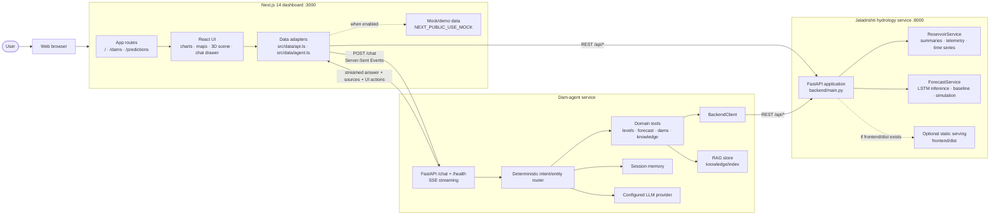
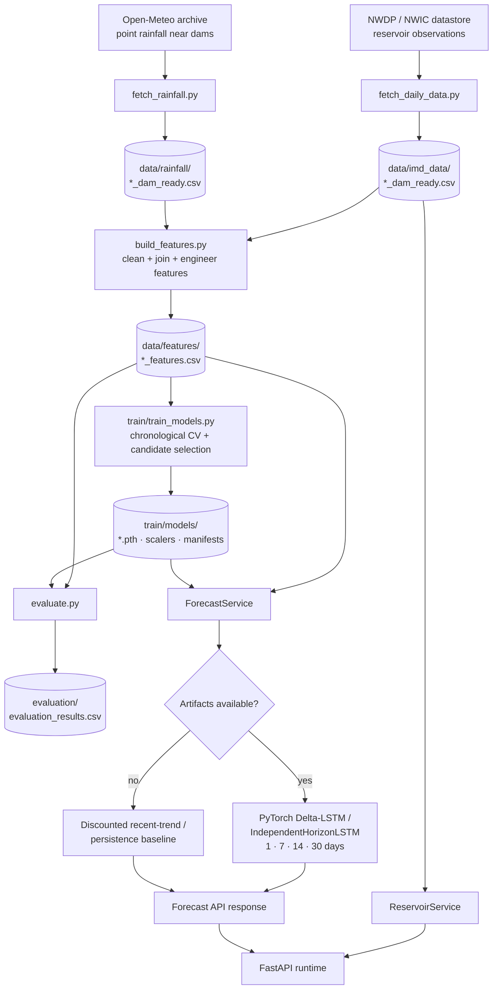

# Jaladrishti Architecture

This document describes the deployed runtime and the offline data/model
pipeline. The diagrams use Mermaid and render in GitHub, VS Code Markdown
preview, and other Mermaid-compatible documentation tools.

## System context and runtime flow

### Runtime responsibilities

- **Next.js dashboard** renders the reservoir register, historical charts,
  forecasts, scenario controls, and chat UI. `src/data/api.ts` validates and
  adapts backend responses with Zod.
- **FastAPI hydrology service** exposes health, statewide summary, reservoir
  telemetry, forecasts, scenario simulation, and evaluation metrics.
- **Dam-agent** provides domain-scoped chat. Its router decides which
  deterministic tools to call; the LLM writes an answer from fetched facts
  and retrieved knowledge. Responses are streamed as SSE events.
- **Filesystem artifacts** are the persistence layer: CSV observations,
  generated features, PyTorch checkpoints, scalers, manifests, evaluation
  results, and the agent's knowledge index.
- There is **no relational database or message broker** in the current
  architecture.

## Data and machine-learning pipeline

## Main API surface

| Method | Route | Component | Purpose |
| --- | --- | --- | --- |
| `GET` | `/api/health` | FastAPI | Service health and monitored dam count |
| `GET` | `/api/summary` | ReservoirService | Statewide capacity, storage, inflow/outflow, and basin totals |
| `GET` | `/api/reservoirs` | ReservoirService | Current telemetry for monitored reservoirs |
| `GET` | `/api/reservoirs/{dam_id}` | ReservoirService | Metadata and historical time series |
| `GET` | `/api/reservoirs/{dam_id}/forecast` | ForecastService | 1-, 7-, 14-, and 30-day storage forecast |
| `POST` | `/api/reservoirs/{dam_id}/simulate` | ForecastService | Rainfall/outflow scenario trajectory |
| `GET` | `/api/evaluation` | ReservoirService | Model benchmark metrics |
| `POST` | `/chat` | Dam-agent | Domain-scoped streamed assistant response |

## Deployment notes

For local development, run the Next.js dashboard and the hydrology API as
separate processes. Start the dam-agent separately when chat is enabled. The
frontend uses `NEXT_PUBLIC_API_BASE_URL` for the hydrology API and
`NEXT_PUBLIC_AGENT_BASE_URL` for the agent service. If a production frontend
build is copied to `frontend/dist`, the FastAPI service can serve its static
assets as a single-process deployment.
